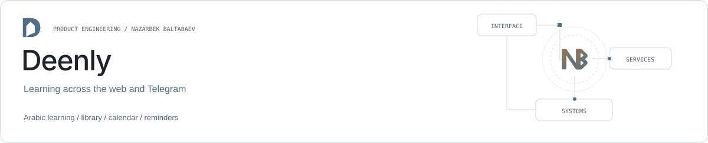

<picture><source media="(prefers-color-scheme: dark)" srcset="assets/banner.svg"></picture>

# Deenly

[Website](https://deenly.uz/) · [Product & architecture](https://github.com/archon1999/engineering-portfolio/blob/main/projects/deenly.md) · [Nazarbek Baltabaev](https://github.com/archon1999)

[](https://github.com/archon1999/DeenlyBot/actions/workflows/ci-cd.yml)

Shaxsiy islomiy o‘rganish va ibodat platformasi: Django backend, Telegram bot
va Minimal UI TypeScript v7.4.0 asosidagi React + MUI frontend. Interfeys va
kontent UZ/RU/EN tillarida ishlaydi. Bot va sayt bitta `TelegramUser` profili,
umumiy domain servislaridan foydalanadi. Lokal baza SQLite, production esa
alohida Docker konteyneridagi PostgreSQL. Bot, sayt va worker bir production
bazasiga ulanadi; lokal baza production ma’lumotlarini almashtirmaydi.

## Tuzilma

```text
Deenly.uz/
  backend/
    apps/             domain servislar, Telegram bot va REST API
    config/           Django sozlamalari va URLlar
    tests/            bot, domain va API testlari
    manage.py
    pyproject.toml
    poetry.lock
    Dockerfile
  frontend/
    src/app/          providers, routes, layouts, Minimal theme
    src/modules/      application/domain/data-access/ui qatlamlari
    src/shared/       generic API, UI, hooks va utilities
    public/           statik assetlar
    package.json
    Dockerfile
  ops/nginx/          SPA, API va Admin uchun bitta origin
  docs/               research va API integratsiya kontrakti
  vendor/             original Minimal ZIP, Git va Dockerga kiritilmaydi
  docker-compose.yml
```

Frontend oqimi: `UI → application hooks → domain repository contract → data-access → HTTP client`.
DTO mapperlari API `snake_case` maydonlarini domain modellariga o‘giradi.
Domain React va transport kodlariga bog‘lanmaydi, sahifalar feature komponentlarni
birlashtiradi. Bu tuzilma Nexa frontend arxitekturasiga mos.

## Interfeys

Minimalning `vite-ts` full versiyasidagi Course, App Welcome, Post va Account
kompozitsiyalari Deenlyning haqiqiy ma’lumotlariga moslashtirilgan. `cp_uz`
LearningLayout namunasiga o‘xshash sticky yuqori header ishlatiladi: keng ekranda
markaziy havolalar, tor ekranda esa tepadan ochiladigan guruhlangan menyu.
Doimiy sidebar va pastki navigatsiya yo‘q. Yorug‘/qorong‘i ko‘rinish, UZ/RU/EN
yorliqlar va arabcha matnlar uchun alohida RTL tipografiya saqlangan.

Bugun, ismlar, arab tili, kutubxona, qazo, taqvim, hisobotlar va sozlamalar
REST APIga ulangan. Dizayndagi progress va statistikalar demo KPI emas.

Headerda CP namunasidagi Solar Linear outlined ikonlar ishlatiladi. Tanlangan
ikonlar va til bayroqlari lokal assetlar: menyuni ochish uchun tashqi ikon
servisi kerak emas. Qidiruv bo‘limlar bo‘yicha ishlaydi; `Ctrl/Cmd+K` bilan
ochiladi. Sozlamalar va profil hisob dropdownida, bosh sahifa esa logoda.
Menyu va drawer fonlari gradientsiz. Sana kiritish MUI DatePicker orqali
UZ/RU/ENga moslashtirilgan. Bosh sahifadagi muhim sanalar bugundan keyingi
6 kalendar oyini qamraydi; oy ko‘rinishiga bog‘liq sanalar `Taxminiy` deb belgilanadi.
Arab tili kartalari darsning haqiqiy dastlabki harf yoki so‘zlarini ko‘rsatadi.

## Mahalliy ishga tushirish

Python 3.12 yoki 3.13, Poetry 2 va Node.js 22 kerak.

Backend:

```powershell
cd backend
poetry install
# Birinchi marta: Copy-Item .env.example .env
poetry run python manage.py migrate
poetry run python manage.py bootstrap_bot
poetry run python manage.py runserver 127.0.0.1:8001
```

Frontend alohida terminalda:

```powershell
cd frontend
npm ci
npm run dev
```

Vite `http://localhost:5173`da ochiladi va API so‘rovlarini `127.0.0.1:8001`ga
proxy qiladi. Development serverlar loopbackga bog‘lanadi.

Bot va worker kerak bo‘lsa backend papkasidan alohida terminallarda
`poetry run python manage.py runbot` va `poetry run python manage.py qcluster`
bajariladi. Production botning ayni tokeni serverda polling qilayotgan bo‘lsa,
mahalliy ikkinchi pollingni ishga tushirmang; development uchun alohida bot kerak.

## Akkaunt va Telegram orqali kirish

Saytga mehmon sifatida, email/parol bilan yoki tasdiqlangan Telegram orqali
kirish mumkin. Mehmon profili ham bazada saqlanadi va sessiya cookie orqali
aniqlanadi. Cookie yo‘qolsa mehmon progressiga qayta kirib bo‘lmaydi; uni
email/parolli akkauntga aylantirish profil va mavjud progressni saqlaydi.
Email hozir login identifikatori: email tasdiqlash va parolni email orqali
tiklash bu bosqichda yo‘q.

Profil sahifasida ismni o‘zgartirish, akkauntni saqlash va Telegram botni
bog‘lash mavjud. Botga bog‘lanmagan profillarga Telegram eslatmalari
yuborilmaydi. Botning shaxsiy owner tekshiruvi saqlangan; veb mehmon/member
kirishi alohida sessiya va profilga tegishlilik tekshiruvlaridan o‘tadi.

Sayt login brauzer sessiyasiga bog‘langan qisqa muddatli challenge yaratadi.
Telegramda bot egasi brauzer va botdagi kodni solishtirib, alohida tugma bilan
tasdiqlagandan keyin sayt o‘sha mavjud profilga Django sessiyasi bilan kiradi.
Havolani ochishning o‘zi kirishni yoki bog‘lashni tasdiqlamaydi. Faqat o‘zingiz
boshlagan so‘rovni tasdiqlang. Mini App raw `initData`si backendda tekshiriladi;
browser yuborgan oddiy Telegram ID login dalili emas.

Bot approval handleri sayt bilan bir DBga ulangan bo‘lishi kerak. Mahalliy va
production turli DBlardan foydalansa, production bot mahalliy sayt challengeini
ko‘rmaydi. Productionga chiqarilganda sayt va bot birga yangilanadi.

Sayt sessiyasi uchun Django auth user bilan mavjud Telegram profilining
OneToOne bog‘lanishi qo‘llanadi; progress yozuvlarining FKlari ko‘chirilmaydi.

Telegramni bog‘lashda ikki profilda ham progress bo‘lsa yoki Telegram profili
boshqa ro‘yxatdan o‘tgan akkauntga tegishli bo‘lsa, xavfsiz konflikt qaytariladi:
ikkala profil saqlanadi, ma’lumotlar yashirincha birlashtirilmaydi.

## Docker

Backend `.env`ni to‘ldiring, keyin root papkadan:

```powershell
docker compose up -d --build
docker compose ps
docker compose logs -f web bot worker frontend
```

Frontend va API `http://127.0.0.1:8080` orqali bitta originda ochiladi. Backend
Admin `http://127.0.0.1:8000/admin/`da ham loopback orqali mavjud. Domen va HTTPS
uchun tashqi reverse proxy 8080ga yo‘naltiriladi.

Compose project nomi mavjud deployment identifikatori bilan bir xil saqlangan.
SQLite volume default nomi `deenlybot_deenly_data`; root papka nomining o‘zgarishi
yangi bo‘sh production bazasini yaratmaydi. Boshqa volume uchun
`DEENLY_DATA_VOLUME`ni aniq belgilang. `docker compose down` datani saqlaydi;
volume o‘chirish alohida va ongli data yo‘qotish operatsiyasi hisoblanadi.

Backend image faqat `backend/` kodidan yig‘iladi. Frontend Node build stage ichida
yig‘ilib, Nginx orqali tarqatiladi; Node production runtime emas. Django static
fayllari migrate/web/frontend o‘rtasida alohida static volume orqali ulashiladi.
Bot tokeni, proxy credentiallari va boshqa secretlar frontend buildiga kirmaydi.
SQLite va jarayon ichidagi auth rate-limit cache uchun web bitta Gunicorn
worker bilan ishlaydi; ko‘p worker qo‘shishdan oldin umumiy cache kerak bo‘ladi.

## Tekshiruvlar

```powershell
cd backend
poetry run ruff check .
poetry run python manage.py check
poetry run python manage.py makemigrations --check --dry-run
poetry run pytest
```

```powershell
cd frontend
npm run check:architecture
npm run typecheck
npm test
npm run build
npm run lint
```

CI backend testlarini SQLite va PostgreSQL’da, frontend qatlam chegaralari,
lint, test va typecheck/buildni bajaradi. Main branch muvaffaqiyatli tekshirilgach
ikkala image GHCRga commit SHA bilan chiqariladi va cheklangan SSH kaliti orqali
productionga avtomatik deploy qilinadi. Prod tokenlari va baza parollari serverda
qoladi; GitHub’da faqat cheklangan deploy kaliti va tekshirilgan SSH host kaliti saqlanadi.

## Hujjatlar va litsenziya

- [Platforma researchi](docs/WEB_PLATFORM_RESEARCH.md)
- [Dizayn researchi](docs/DESIGN_RESEARCH.md)
- [API kontrakti](docs/API_CONTRACT.md)
- [Production deploy va progressni saqlash](docs/PRODUCTION_RUNBOOK.md)
- [Frontend qatlamlari](frontend/AGENTS.md)

Minimalning original litsenziya havolalari `frontend/LICENSE.md`da saqlangan.
Solar ikonlari atribusiyasi `frontend/NOTICE.md`da. Tanlangan Arch D logosi,
uning original konsepti va prompti `docs/logo-concepts/`da. Asosiy interfeys va
favicon bir xil production SVG geometriyasidan foydalanadi; boshqa variantlar
va eski template logolari aktiv loyihadan olib tashlangan.
Original ZIP `vendor/`da; uni `.env`, SQLite va runtime fayllari bilan birga Git
yoki Docker kontekstiga qo‘shmang. Nexa faqat arxitektura namuna sifatida o‘qildi;
uning TMS biznes modullari va credentiallari ko‘chirilmaydi.
`cp_uz`dan faqat navigatsiya va vizual tuzilma o‘rganildi; uning biznes kodi,
foydalanuvchi ma’lumotlari yoki sozlamalari ko‘chirilmagan.
